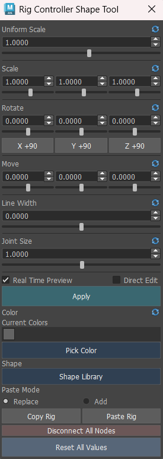
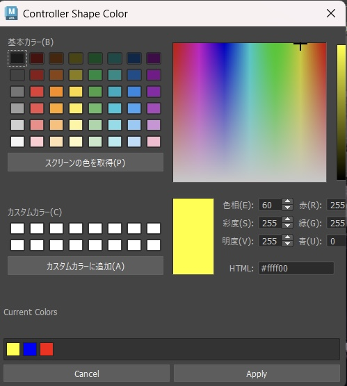

# Rig Controller Shape Tool

[](https://github.com/Yuzuki-Midoshima/Rig-Ctrl-Shape-Tool/actions/workflows/ci.yml)


Autodesk Maya 2026上で、**リグコントローラーを安全かつ直感的に調整するためのツール**です。




拡大縮小 / 回転 / 移動 / 線幅 / カラー / シェイプのコピーなど、  コントローラー調整で頻繁に行う操作をひとつの画面にまとめています。

リガーのリグ制作・調整だけでなく、アニメーターが完成したリグを壊すことなく自分が扱いやすい形・大きさ・色へ調整できることを想定しています。

**「選ぶ → 試す → 見る → 決める」**

というシンプルな操作で、  
リグ内部の構造を過度に意識せずコントローラーを編集できることを重視しています。

---

# 主な機能

- **シェイプ調整**  
  全体 / XYZごとの拡大縮小、回転、移動、90°回転

- **リアルタイムプレビュー**  
  数値やスライダーによる変更をビューポートへリアルタイムに反映

- **直接編集モード**  
  Maya上でコントローラーシェイプを直接操作し、そのまま即時反映

- **微調整**  
  スライダーと数値入力を使い分け、大まかな調整から細かな調整まで対応

- **カラー編集**  
  カラーピッカー / HSV / RGB / HEX / 既定色 / カスタムカラー

- **シェイプライブラリ**  
  別途制作したController Shape Libraryをツール内から利用

- **シェイプのコピー / ペースト**  
  既存リグへの影響を考慮しながら、コントローラーシェイプを置換 / 追加

- **線幅 / ジョイントサイズ**  
  ビューポート上の視認性を同じ画面から調整

- **複数コントローラー対応**  
  複数選択したコントローラーをまとめて編集

- **Undo / ロールバック**  
  試した結果を確認しながら、安全に操作前の状態へ戻すことが可能

---

# シェイプ編集


コントローラーのTransformを変更せず、  
**カーブシェイプの大きさ・向き・位置を調整**できます。

対応している操作は、

- 全体の拡大縮小
- XYZごとの拡大縮小
- XYZ回転
- 90°回転
- XYZ移動
- 線幅
- ジョイントサイズ

です。

Maya標準機能でカーブシェイプを編集する場合は、  
コンポーネントモードへ切り替えてCVを選択し、  
編集内容に応じて拡大縮小 / 回転 / 移動を行う必要があります。

本ツールでは、コントローラーを選択したまま  
ひとつの画面からシェイプを調整できます。

```text
コントローラーを選択
        ↓
拡大縮小 / 回転 / 移動
        ↓
ビューポートで確認
        ↓
微調整
        ↓
確定
```

---

## シェイプ中心での変形

拡大縮小 / 回転では、  
コントローラーのTransform Pivotではなく、

**実際に表示されているカーブシェイプの中心**

を編集基準として使用します。

リグでは、コントローラーのTransform原点と  
カーブシェイプの中心が一致しているとは限りません。

TransformのPivotを基準に拡大縮小 / 回転すると、  
シェイプの大きさや向きだけを変更したい場合でも  
表示位置までずれてしまうことがあります。

そこで、コントローラーごとにカーブシェイプの中心を取得し、

**TransformやPivotを変更せず、  
見えているシェイプをその場で編集**

できるようにしています。

複数のコントローラーを選択した場合も、  
選択全体の中心ではなく、それぞれのコントローラーを独立して処理します。

---

# 2つの編集方法

コントローラーシェイプの編集には、

- **リアルタイムプレビュー**
- **直接編集モード**

の2つの方法があります。

数値による正確な調整と、  
Maya上でシェイプを見ながら行う直感的な調整を、  
用途に応じて使い分け・併用できます。

```text
                  シェイプ編集
                       │
                       ▼
               コントローラーを選択
                       │
             ┌─────────┴─────────┐
             │                   │
             ▼                   ▼
  リアルタイムプレビュー      直接編集モード
       数値で調整              直接操作
             │                   │
             ▼                   ▼
       確認して適用          Maya上で即時反映
             │                   │
             └─────────┬─────────┘
                       ▼
              コントローラーシェイプ
```

---

## リアルタイムプレビュー


リアルタイムプレビューを有効にすると、  
数値やスライダーを変更した結果を  
ビューポートへリアルタイムに反映します。

通常であれば、

```text
値を変更
   ↓
適用
   ↓
確認
   ↓
Undo
   ↓
再調整
```

となる操作を、

```text
値を変更
   ↓
その場で確認
   ↓
微調整
   ↓
適用
```

という流れで行えます。

プレビュー中は編集前のシェイプ情報を保持しており、  
適用するまでは変更を確定しません。

プレビューをOFFにした場合や、  
ウィンドウを閉じた場合、別の編集へ移った場合には、  
未確定の変更を元の状態へ戻します。

**気軽に数値を動かして比較し、  
良い結果だけを確定できること**

を重視しています。

---

## 直接編集モード


実際のリグ制作でツールを使用する中で、  
数値入力と適用を繰り返すだけでなく、

**Mayaと同じ感覚で直接編集できる方が効率的**

だと感じたため追加しました。

直接編集モードでは、  
Maya上でコントローラーシェイプを直接操作し、  
変更をそのまま即時反映できます。

適用操作を必要としないため、  
ひとつのコントローラーを調整したあと、  
そのまま別のコントローラーを選択して連続して編集できます。

細かなシェイプ調整や、  
複数のコントローラーをまとめて整える作業を想定しています。

リアルタイムプレビューとの併用、  
Maya標準のUndoにも対応しています。

---

# 微調整

各変形項目には、  
**数値入力とスライダーの両方**を用意しています。

スライダーではビューポートを見ながら感覚的に調整し、  
数値入力では正確な値や細かな差を調整できます。

さらに数値入力では、  
カーソルが置かれている桁に応じて増減量が変化します。

```text
スライダーで大まかに調整
        ↓
数値入力で微調整
```

という流れを、  
刻み幅の設定を切り替えることなく行えます。

各項目は個別にリセットできるため、

> スケールは残して、回転だけやり直したい

といった場合でも、  
他の調整内容を維持したまま対象項目だけを戻せます。

---

# カラー編集


シェイプだけでなく、  
**コントローラーの色も同じツールから調整**できます。

用途に合わせて、

- カラーピッカー
- HSV
- RGB
- HEX
- 既定色
- カスタムカラー
- 画面から色を取得

など、複数の方法から色を指定できます。

感覚的に色を探したい場合と、  
決まった値を正確に使用したい場合の両方に対応しています。

---

## カラーパレット



あらかじめ用意した既定色に加えて、  
頻繁に使用する色を**カスタムカラーとして登録**できます。

例えば、

- 左 / 右
- 中央コントローラー
- IK / FK
- キャラクター固有のコントローラーカラー

などを登録しておけば、  
毎回数値を入力し直す必要がありません。

また、現在選択しているコントローラーの色を一覧表示し、  
その色をそのまま別のコントローラーへ使用できます。

---

## カラープレビュー

カラーダイアログで色を変更すると、  
選択中のコントローラーへリアルタイムにプレビューします。

```text
色を選ぶ
   ↓
Maya上で確認
   ↓
別角度から確認
   ↓
微調整
   ↓
確定
```

適用するまでは編集前のカラー状態を保持しているため、  
試した色が合わなければキャンセルで元の状態へ戻せます。

カラーダイアログは非モーダルで設計しているため、  
ダイアログを開いたまま、

- ビューポートを回転
- コントローラーを別角度から確認
- Outlinerを操作
- シーン全体との色のバランスを確認

といったMaya側の操作を続けられます。

**実際のMayaビューポート上での見え方を確認しながら  
色を決められること**を重視しています。

---

# シェイプライブラリ


別途制作した **Controller Shape Library** を、  
本ツールから直接呼び出して使用できます。

登録されたシェイプを視覚的に選択して  
コントローラーを作成できます。


Controller Shape Libraryでは、

- 登録済みシェイプからのコントローラー作成
- テキストコントローラー
- シェイプ結合
- カラー設定
- 位置 / 回転スナップ
- ZERO / OFFSETグループ作成
- ライブラリ登録

などを行えます。

Controller Shape Libraryは単体でも使用でき、

**独立したツールの機能を、  
別のツールから再利用できる構成**

にしています。

詳細はこちら  
https://github.com/Yuzuki-Midoshima/Controller-Shape-Library

---

# シェイプのコピー / ペースト


**Copy Rig / Paste Rig**は、  
本ツールで特に重視している機能のひとつです。

完成済みリグのコントローラーについて、

**既存リグへの影響を考慮しながら、  
見た目のカーブシェイプを別のシェイプへ変更**

できます。

一般的な「コピー元 → コピー先」というコピー / ペーストとは異なり、  
最初に基準とする既存リグのコントローラーを  
`Copy Rig`で記録します。

その後、新しい見た目として使用したいコントローラーを選択して  
`Paste Rig`を実行します。

```text
既存リグのコントローラー
        │
        │ Copy Rig
        ▼
     対象を記録
        │
        │
新しいシェイプのコントローラー
        │
        │ Paste Rig
        ▼
選択した方法に応じて再構築
```

用途に応じて、  
**Replace** と **Add** の2つの方法を使用できます。

---

## Replace


`Paste Mode: Replace`では、  
`Copy Rig`で記録した既存リグのコントローラーシェイプを、  
`Paste Rig`実行時に選択しているシェイプへ置き換えます。

```text
既存リグのコントローラー
Transform / リグ上の役割 / 接続
              +
              │
              │ シェイプのみ置換
              ▼
      新しいシェイプ
```

記録したコントローラーのリグ上の役割を維持したまま、  
見た目を変更することを目的としています。

Translate / Rotate / Scale / Pivotなど、  
既存コントローラーが持つTransformを不用意に変更せず、  
シェイプを変更できます。

> 「このコントローラーの動作や配置はそのまま維持して、  
> 操作しやすい別のシェイプへ変更したい」

といった場合に使用できます。

---

## Add


`Paste Mode: Add`では、  
`Copy Rig`で記録した既存リグのコントローラーをもとに  
新しいコントローラーを構築します。

新しい見た目として使用するシェイプへ置き換えたうえで、  
元のコントローラーから対応可能なTransform接続を  
新しいコントローラーへ移行します。

```text
Replace
既存コントローラーを維持
        ↓
シェイプを置換


Add
新しいコントローラーを構築
        ↓
対応可能な接続を移行
```

同じシェイプ変更でも内部の処理方法が異なるため、  
用途に応じてReplace / Addを選択できます。

---

## カーブ情報の保持

コピー / ペーストでは、  
CV位置だけではなく、カーブシェイプを再構築するために必要な

- CV
- Degree
- Knot
- Form
- Rational

などのカーブ情報を取得します。

これにより単純なカーブだけでなく、  
Periodic CurveやRational Curveも考慮して  
シェイプを再構築します。

表示設定はカーブ情報とは別に取得し、  
生成するシェイプへ可能な範囲で引き継ぎます。

---

# 接続解除


**Disconnect All Nodes**では、  
選択したコントローラーに対する接続解除をまとめて実行します。

コントローラーおよびカーブシェイプの接続を整理し、  
必要なアトリビュート状態や親子関係も処理します。

処理全体はひとつのUndoとして実行されるため、  
MayaのUndoで操作前の状態へ戻すことができます。

---

# 制作・改善

このツールは、リグ制作で頻繁に行う  
**コントローラーシェイプの調整を効率化するツール**として制作を始めました。

当初は、

```text
拡大縮小
   +
回転 / 移動
   +
線幅
   +
シェイプのコピー / ペースト
```

など、繰り返し行う調整作業を  
ひとつのツールから行えるようにしていました。

その後、実際のリグ制作で使用しながら、  
操作性や制作の流れに合わせて機能を追加・調整しています。

---

## カラー編集の追加

シェイプの形だけでなく、

**「色も同じ場所から調整したい」**

という制作の流れからカラー編集を追加しました。

カラーピッカーだけではなく、  
HSV / RGB / HEX / 既定色 / カスタムカラーなど、  
用途によって入力方法を選択できます。

また、実際のリグ上で色を比較できるよう  
リアルタイムプレビューとロールバックにも対応しています。

---

## シェイプライブラリの追加

コントローラーを調整するだけでなく、  
新しいシェイプの作成まで同じ流れで行えるよう、

別途制作した **Controller Shape Library** を組み込みました。

```text
シェイプを選ぶ
      ↓
コントローラーを作成
      ↓
大きさ / 向きを調整
      ↓
カラーを調整
      ↓
既存リグへ使用
```

といった一連の作業を、  
ツールを行き来せず行えるようにしています。

---

## 直接編集モードの追加

数値入力とスライダーによる編集を使用する中で、

**細かな調整では、Maya上で直接触った方が速い**

と感じる場面がありました。

そこで、従来のリアルタイムプレビューに加えて  
直接編集モードを追加しました。

```text
正確に調整したい
      ↓
数値 / スライダー


感覚的に調整したい
      ↓
直接編集
```

どちらか一方へ統一するのではなく、  
作業内容によって使い分けられるようにしています。

---

# リガー / アニメーター双方を意識した設計

本ツールは、

**リガーとアニメーターの両方が扱えること**

を前提に設計しています。

リガーには、  
コントローラー制作・調整を効率化するための細かな編集機能を。

アニメーターには、  
コンポーネントモードやShape Nodeなどの  
リグ内部を直接操作せず、

**自分が扱いやすいコントローラーへ調整できる環境**

を提供することを目指しています。

専門的な処理はツール側で行い、  
ユーザー側の操作はできるだけ、

**「選択して、見ながら調整する」**

という形にまとめています。

---

# 安全性

操作の速さと同じくらい、

**意図しない変更を防ぎ、  
失敗した場合に安全に戻れること**

を重視しています。

主に、

- Transform / Pivotを不用意に変更しない
- プレビューは適用前なら元の状態へ戻せる
- 直接編集は即時反映 + Undo対応
- 項目単位でリセット可能
- 複数のコントローラーを独立して処理
- カラー変更はキャンセルで復元
- 選択状態を可能な限り復元
- コピー / ペースト失敗時のロールバック
- ウィンドウを閉じた際の未確定編集の復元

などの処理を行っています。

コピー / ペーストや接続解除など、  
リグ構造への影響が大きい処理では、  
不正な状態を操作前に確認します。

エラーを単純に無視するのではなく、  
ユーザー側で修正できる問題は警告として通知し、  
予期しない問題と分けて扱います。

---

## Undo / ロールバック

通常の編集操作は、  
MayaのUndo単位でまとめています。

ひとつのツール操作によって  
Undo履歴が細かく分割されないようにしています。

リアルタイムプレビューやカラープレビューなど、  
複数の操作にまたがる編集では開始時の状態を記録し、

- 適用
- キャンセル
- プレビューOFF
- ウィンドウを閉じる
- 別編集の開始
- 処理中の例外

などの状態に応じて、  
確定またはロールバックします。

---

## 選択状態の保持

コピー / ペーストなど、  
内部で選択状態を変更する処理では、

操作前の選択状態を保存し、  
処理終了後に可能な範囲で復元します。

ツールを使用したことで、

> 「今どのコントローラーを触っていたのか分からなくなる」

状態を避け、  
連続した作業を妨げないようにしています。

---

# 設計構造

ツール内部は、  
画面とMaya操作を直接結びつけず、  
役割ごとに処理を分離しています。

```text
画面
 ↓
機能
 ↓
サービス
 ↓
Maya API
```

### 画面

画面表示、入力、シグナルなどを担当します。  
Mayaシーンの具体的な編集処理は行いません。

### 機能

変形、プレビュー、直接編集、カラー、  
コピー / ペースト、接続解除など、  
ユーザー操作単位の処理を担当します。

### サービス

各機能が必要とする操作をMaya APIへ橋渡しします。

カーブシェイプの取得、選択状態、Undoなど、  
Maya固有の処理をこの層へまとめています。

### コア

Maya / Qtに依存しない状態管理、  
Transform計算、編集状態の管理などを担当します。

これにより、  
ツールの中心となる処理をDCC環境から分離しています。

---

## この構成にした理由

個人制作のMayaツールでは、  
すべての処理をひとつのPythonファイルへまとめることもできます。

本ツールでは、  
機能追加を続けた場合でも既存機能を壊しにくくするため、  
役割ごとに処理を分離しています。

一方で、複雑な構造にすること自体を目的にはしていません。

**小規模ツールとして追いやすい構造を保ちながら、  
変更に耐えられる設計にすること**

を方針としています。

---

# テスト

機能追加や調整を繰り返しても  
既存機能を壊さないよう、自動テストを用意しています。

主に、

- Transform計算
- プレビューの確定 / ロールバック
- カラーの確定 / ロールバック
- Undo / Redo
- 複数コントローラー
- Periodic / Rational Curve
- Copy / Replace / Add
- 接続の移行
- 接続解除
- Namespace
- Referenced Node
- Locked Nodeでの失敗時ロールバック
- 選択状態の復元
- ウィンドウのライフサイクル
- 画面のコンテキストメニュー

などを確認しています。

Maya GUI固有のビューポート操作や  
ダイアログの実操作については自動テストと分け、  
Maya 2026上で手動確認しています。

---

# 技術情報

- Autodesk Maya 2026
- Python 3
- PySide6
- Maya Python API
- Maya Undo
- Qt

### 主な技術要素

- カーブシェイプ中心を利用したTransform処理
- リアルタイムプレビューの状態管理
- 直接編集による即時シェイプ編集
- カラー状態の記録 / 復元
- カーブシェイプ情報の記録 / 再構築
- Undo / ロールバック管理
- 選択状態の保持
- Periodic / Rational Curve対応
- 画面とMayaシーン処理の分離

---

# 動作環境

- Autodesk Maya 2026
- Python 3
- PySide6

Maya 2026に同梱されているPython環境での使用を想定しています。

---

# インストール

リポジトリをMayaの`scripts`フォルダへ配置します。

```text
<Maya userAppDir>/scripts/Rig-Ctrl-Shape-Tool/
```

構成例：

```text
Rig-Ctrl-Shape-Tool/
├─ launch.py
├─ dev_launch.py
├─ app.py
│
├─ core/
├─ features/
├─ services/
├─ maya/
├─ ui/
├─ tests/
│
└─ docs/
   ├─ images/
   │  ├─ rig-controller-shape-tool.png
   │  ├─ color-editing.png
   │  └─ shape-library.png
   │
   └─ gifs/
      ├─ shape-transform.gif
      ├─ real-time-preview.gif
      ├─ direct-edit.gif
      ├─ color-editing.gif
      ├─ shape-library.gif
      ├─ copy-paste-shape.gif
      ├─ replace.gif
      ├─ add.gif
      └─ disconnect.gif
```

---

## 起動方法

通常起動には、  
リポジトリ直下の`launch.py`を使用します。

MayaのスクリプトエディタのPythonタブから起動する場合：

```python
import os
import runpy
import maya.cmds as cmds

maya_dir = os.path.normpath(
    cmds.internalVar(userAppDir=True)
)

launch_file = os.path.join(
    maya_dir,
    "scripts",
    "Rig-Ctrl-Shape-Tool",
    "launch.py",
)

runpy.run_path(
    launch_file,
    run_name="__main__"
)
```

`launch.py`がツールパッケージの読み込みと起動を行います。

---

## シェルフへの登録

上記のスクリプトエディタ用コードを  
Pythonのシェルフボタンへ登録することで、  
通常使用時はシェルフから起動できます。

`dev_launch.py`は開発時の読み込み用として配置しています。

---

# ライセンス

MIT License

Copyright (c) 2026 Yuzuki Midoshima